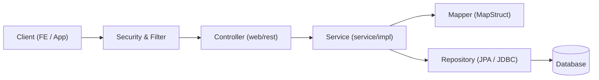

# Khung Cấu Trúc Dự Án Backend (Java & Spring Boot)

Tài liệu này tổng hợp cấu trúc chuẩn hóa rút ra từ dự án thực tế **Spring Boot (Enterprise / JHipster-style)**, dùng làm bộ khung tham chiếu (blueprint) để khởi tạo và tổ chức mã nguồn cho các dự án Backend về sau.

---

## 1. Tech Stack Tiêu Chuẩn

| Thành phần | Công nghệ gợi ý | Mục đích |
| :--- | :--- | :--- |
| **Ngôn ngữ & Framework** | Java 17/21, Spring Boot 3.x | Nền tảng xây dựng RESTful API |
| **Build Tool** | Maven (`pom.xml` + `mvnw`) | Quản lý thư viện và đóng gói `.jar` |
| **Database & ORM** | PostgreSQL, Spring Data JPA, Hibernate 6 | Lưu trữ dữ liệu & ánh xạ hướng đối tượng |
| **DB Migration** | Liquibase hoặc Flyway | Quản lý phiên bản schema DB tự động |
| **Mapping & Boilerplate** | MapStruct, Lombok | Giảm code lặp (`getter/setter`, convert Entity <-> DTO) |
| **Bảo mật** | Spring Security, OAuth2 / JWT (Keycloak) | Xác thực và phân quyền người dùng |
| **Cache** | Redis hoặc Hazelcast (`@Cacheable`) | Tăng tốc truy vấn dữ liệu ít thay đổi |
| **Message Broker** | Apache Kafka (`@KafkaListener`, `KafkaTemplate`) | Xử lý bất đồng bộ, giao tiếp giữa các service |
| **Realtime & Jobs** | WebSocket (STOMP), Spring Scheduler / Quartz | Thông báo realtime & chạy tác vụ định kỳ |
| **Tài liệu API** | Springdoc OpenAPI (Swagger UI) | Tự động sinh giao diện test API |
| **Container & CI/CD** | Docker, Docker Compose, Jenkins / GitHub Actions | Đóng gói và triển khai đa môi trường |

---

## 2. Cây Thư Mục Chuẩn (Project Tree)

```text
<project-name>/
├── .vscode/                        # Cấu hình IDE dùng chung (JDK, env terminal, formatter)
│   └── settings.json
├── src/
│   ├── main/
│   │   ├── docker/                 # Các file docker-compose phụ trợ (postgres, redis, keycloak...)
│   │   ├── java/com/<company>/<app>/
│   │   │   ├── <AppName>App.java   # Main class khởi chạy Spring Boot
│   │   │   ├── aop/                # Aspect-Oriented Programming (logging, audit)
│   │   │   ├── broker/             # Kafka Producer, Consumer, Event payload & config
│   │   │   ├── config/             # Cấu hình Bean: Security, DB, Cache, WebSocket, CORS, S3...
│   │   │   ├── domain/             # JPA Entities (ánh xạ 1-1 với bảng trong Database)
│   │   │   ├── listener/           # Application Event Listeners (sự kiện nội bộ Spring)
│   │   │   ├── repository/         # Spring Data JPA Repositories
│   │   │   │   └── custom/         # Custom Repository cho SQL động / báo cáo phức tạp
│   │   │   │       └── impl/       # Triển khai bằng NamedParameterJdbcTemplate
│   │   │   ├── scheduler/          # Các Cron Job định kỳ (@Scheduled / Quartz)
│   │   │   ├── security/           # JWT / OAuth2 utils, SecurityContext, Authorities
│   │   │   ├── service/            # Service Interfaces (khai báo hợp đồng nghiệp vụ)
│   │   │   │   ├── dto/            # Data Transfer Objects (Request / Response payload)
│   │   │   │   │   └── response/   # Wrapper phản hồi chung (CommonResponse)
│   │   │   │   ├── exception/      # Custom Business Exceptions
│   │   │   │   ├── impl/           # Service Implementations (xử lý logic chính)
│   │   │   │   ├── mapper/         # MapStruct Mappers (Entity <-> DTO)
│   │   │   │   ├── model/          # Model phụ trợ (DynamicFilter, FilterEntity...)
│   │   │   │   └── util/           # Constants, StringUtil, DateUtil, NumberUtil...
│   │   │   └── web/
│   │   │       └── rest/           # REST Controllers (*Resource.java / *Controller.java)
│   │   │           └── errors/     # Global Exception Handler (@RestControllerAdvice)
│   │   └── resources/
│   │       ├── config/
│   │       │   ├── application.yml         # Cấu hình mặc định chung
│   │       │   ├── application-dev.yml     # Ghi đè cho môi trường dev/local
│   │       │   ├── application-prod.yml    # Ghi đè cho môi trường production
│   │       │   └── liquibase/              # Changelog tạo/sửa bảng DB
│   │       ├── i18n/                       # File thông báo đa ngôn ngữ
│   │       ├── templates/                  # Template Email / HTML (Thymeleaf)
│   │       └── logback-spring.xml          # Cấu hình ghi log console & file
│   └── test/                       # Unit Test & Integration Test (JUnit 5, Mockito, Testcontainers)
├── Dockerfile                      # Đóng gói ứng dụng thành Docker Image
├── docker-compose.yaml             # Chạy ứng dụng và các dịch vụ phụ thuộc
├── Jenkinsfile                     # Pipeline CI/CD (build, test, deploy)
├── pom.xml                         # Quản lý dependencies & Maven plugins
├── mvnw / mvnw.cmd                 # Maven Wrapper (chạy không cần cài Maven toàn cục)
├── .gitignore
└── README.md                       # Hướng dẫn cài đặt và chạy dự án
```

---

## 3. Trách Nhiệm Từng Tầng (Layered Architecture)



| Tầng | Package | Nguyên tắc thiết kế |
| :--- | :--- | :--- |
| **Controller** | `web.rest` | Chỉ nhận HTTP Request, validate đầu vào (`@Valid`), gọi Service và trả về `CommonResponse`. **Không viết logic nghiệp vụ tại đây.** |
| **Service** | `service` & `service.impl` | Tách Interface và Implementation. Chứa toàn bộ business logic, quản lý `@Transactional`, gọi nhiều Repository / Mapper / External Service. |
| **DTO & Mapper** | `service.dto`, `service.mapper` | **Không trả Entity trực tiếp ra API.** Dùng DTO để kiểm soát dữ liệu vào/ra và MapStruct để convert tự động. |
| **Repository** | `repository` | CRUD đơn giản dùng `JpaRepository` + Derived Query; truy vấn vừa dùng `@Query` (JPQL); báo cáo/lọc động phức tạp dùng `NamedParameterJdbcTemplate` ở `repository/custom`. |
| **Domain** | `domain` | Khai báo bảng DB (`@Entity`). Tạo lớp cha `AbstractAuditingEntity` chứa các cột dùng chung (`id`, `createdBy`, `createdAt`, `updatedBy`, `updatedAt`, `isActive`) để mọi Entity kế thừa. |
| **Exception** | `service.exception`, `web.rest.errors` | Service ném `CustomException(HttpStatus, message)`; `ExceptionTranslator` (`@RestControllerAdvice`) bắt tập trung và trả JSON lỗi thống nhất. |

---

## 4. Quy Ước Đặt Tên (Naming Conventions)

Giữ quy ước đặt tên nhất quán giúp đọc code và tìm file cực nhanh:

| Loại thành phần | Quy ước đặt tên | Ví dụ (Module `Employee`) |
| :--- | :--- | :--- |
| **Controller** | `<Module>Resource.java` hoặc `<Module>Controller.java` | `EmployeeResource.java` |
| **Service Interface** | `<Module>Service.java` | `EmployeeService.java` |
| **Service Impl** | `<Module>ServiceImpl.java` | `EmployeeServiceImpl.java` |
| **Repository** | `<Module>Repository.java` | `EmployeeRepository.java` |
| **Custom Repository** | `<Module>CustomRepository.java` / `*Impl.java` | `EmployeeDashboardRepositoryImpl.java` |
| **Entity** | `<Module>Entity.java` | `EmployeeEntity.java` |
| **DTO** | `<Module>DTO.java` (hoặc `*RequestDTO`, `*ResponseDTO`) | `EmployeeDTO.java` |
| **Mapper** | `<Module>Mapper.java` | `EmployeeMapper.java` |
| **REST Endpoint** | Số nhiều, viết thường, nối bằng gạch ngang (`kebab-case`) | `/api/employees`, `/api/recruitment-posts` |
| **Database Table / Column** | Viết thường, nối bằng gạch dưới (`snake_case`) | `employee_contract`, `created_at` |

---

## 5. Quy Trình 6 Bước Khi Làm 1 Tính Năng / API Mới

1. **Database & Entity**: Tạo/cập nhật bảng (qua Liquibase/SQL) -> tạo hoặc sửa `*Entity.java`.
2. **Repository**: Tạo `*Repository extends JpaRepository<*Entity, Long>` và các hàm query cần thiết.
3. **DTO & Mapper**: Tạo `*DTO.java` và `*Mapper.java` (MapStruct).
4. **Service**: Khai báo method ở `*Service.java` -> viết logic nghiệp vụ ở `*ServiceImpl.java` (có `@Transactional` và validate ném `CustomException`).
5. **Controller**: Mở endpoint trong `*Resource.java`, bọc kết quả bằng `CommonResponse`.
6. **Kiểm thử**: Test bằng Swagger UI / Postman và kiểm tra dữ liệu thực tế trong DB.

---

## 6. Checklist Cấu Hình Khi Khởi Tạo Dự Án Mới

- [ ] **Java & Maven**: Cố định phiên bản Java (`17` hoặc `21`) trong `pom.xml` và `.vscode/settings.json`.
- [ ] **TimeZone**: Chuẩn hóa múi giờ ngay từ hàm `main()` (ví dụ `Asia/Ho_Chi_Minh` hoặc `UTC`) để tránh lệch giờ giữa JVM và PostgreSQL.
- [ ] **Multi-Profile**: Tách `application.yml` (chung) và `application-dev.yml`, `application-prod.yml` (riêng theo môi trường); không hardcode mật khẩu production vào git (dùng biến môi trường `${DATABASE_PASSWORD}`).
- [ ] **Response & Error chuẩn**: Tạo sẵn `CommonResponse<T>`, `CustomException`, và `GlobalExceptionHandler` ngay từ đầu.
- [ ] **Docker local**: Tạo sẵn `docker-compose.yaml` cho PostgreSQL / Redis / Kafka để thành viên mới chỉ cần `docker compose up -d` là chạy được ngay.
